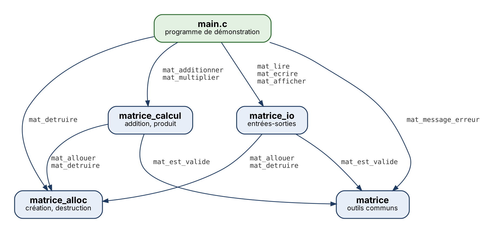
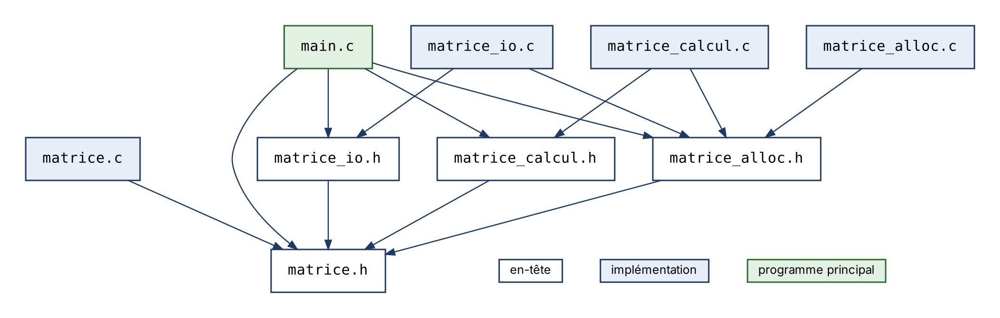

# TD — Stockage de matrices en C

| | |
|---|---|
| **Membres** | ZIAD Nizar `@hassanhassoul`, FAUCHEUX Robin `@RobinFaucheux` |
| **Groupe** | TD1 |
| **Remise** | 2 novembre 2026 |
| **Cours** | INSA Centre Val de Loire, 3e année STI, Programmation C (A. ADELL) |

## Sommaire

1. [Introduction](#1-introduction)
2. [Conception](#2-conception)
3. [Réalisation](#3-réalisation)
   - [Exercice 1](#exercice-1)
   - [Exercice 2](#exercice-2)
   - [Exercice 3](#exercice-3)
   - [Exercice 4](#exercice-4)
4. [Vérifications mémoire](#4-vérifications-mémoire)
5. [Démonstration](#5-démonstration)
6. [Bilan](#6-bilan)

## 1. Introduction

Le but du TD est d'écrire une petite bibliothèque C pour manipuler des matrices d'entiers : les créer sur le tas, les lire et les écrire dans un fichier texte, les afficher, puis calculer leur somme et leur produit. Le code est réparti en quatre modules dont les `.h` sont imposés (`matrice`, `matrice_alloc`, `matrice_io`, `matrice_calcul`), et le programme `demo_matrices` les assemble.

Le cœur du TD, c'est la gestion de la mémoire : allouer une matrice en deux niveaux, rattraper proprement un échec au milieu de l'allocation, et respecter les règles R1 à R7 pour qu'aucun chemin du programme ne fuie.

**À la remise, tout fonctionne.** Les quatre exercices sont terminés. `test_ex1` donne 16/16, `test_ex2` 14/14 et `test_ex3` 14/14. Les dix scénarios du sujet donnent le résultat attendu. La compilation avec `-std=c11 -Wall -Wextra -Wpedantic` ne produit aucun avertissement, et valgrind ne trouve aucune fuite, même sur les cas d'erreur. Les `.h` fournis n'ont pas été modifiés.

Seule limite connue : si un fichier contient des valeurs en trop après les n × p coefficients, elles sont ignorées sans erreur (voir Q4.2).

## 2. Conception

### Modules

Une flèche veut dire " appelle des fonctions de ".



Seul `matrice_alloc` appelle `calloc` et `free` : la lecture et les calculs passent par `mat_allouer` et `mat_detruire`. `matrice_calcul` ne dépend pas de `matrice_io`, on peut donc calculer sans jamais ouvrir de fichier.

### Inclusions

Ici, X → Y veut dire que X fait `#include "Y"`.



Chaque `.c` inclut son propre `.h`, comme ça le compilateur vérifie que prototypes et définitions correspondent. La garde `#ifndef` est indispensable parce que `main.c` reçoit `matrice.h` quatre fois : directement, puis via les trois autres en-têtes. On a essayé sans la garde, et gcc s'arrête sur `redefinition of 'struct matrice'` et `redeclaration of enumerator 'MAT_OK'`.

### Propriété de la mémoire

Le principe : seul `mat_allouer` alloue, seul `mat_detruire` libère, et une matrice est toujours soit complète, soit vide (`MATRICE_VIDE`). Le propriétaire est celui qui a reçu `MAT_OK`. Après un échec, l'appelant n'a rien à libérer, mais il peut quand même appeler `mat_detruire` sans risque.

| Règle | Où on l'applique |
|---|---|
| R1 : initialiser à `MATRICE_VIDE` | `a`, `b`, `r` dans `main`, `r` dans les calculs, `tmp` dans `mat_lire` (on a ajouté `= MATRICE_VIDE`) |
| R2 : un succès transfère la propriété | `*res` n'est rempli qu'à la toute fin (1.e, 2.f, 3.d, 3.h) |
| R3 : un échec laisse `*res` vide | lignes déjà obtenues rendues (1.d), `mat_detruire(&tmp)` (2.e), `mat_detruire(&r)` avant chaque erreur (3.g) |
| R4 : une entrée n'est jamais modifiée | entrées passées en `const Matrice *` |
| R5 : `res` distinct des entrées | `verifier_parametres` refuse `res == a` ou `res == b` |
| R6 : `mat_detruire` remet à vide | test `coef != NULL`, puis `*m = MATRICE_VIDE` |
| R7 : qui ouvre ferme | `fopen`/`fclose` seulement dans `charger` et `sauvegarder` |

### Choix

- **Fonctions `static`** : `mat_calloc`, `lire_entier`, `verifier_parametres`, `tient_dans_int`, `charger` et `sauvegarder` ne servent qu'à l'intérieur de leur fichier. En `static`, elles restent hors des `.h` et ne risquent pas de conflit de noms à l'édition de liens. `mat_test_allocs_autorisees` fait exception, car les tests doivent pouvoir la modifier.
- **Échec partiel** : chaque fonction qui alloue rend tout ce qu'elle a obtenu avant de renvoyer une erreur, et ne remplit `*res` qu'une fois le résultat complet.
- **Dépassement** : on calcule en `long long` et on vérifie que le résultat tient dans un `int` avant de le stocker. Pour le produit, on vérifie aussi avant chaque addition que la somme ne sort pas des bornes du `long long`.

### Compilation

Le [Makefile](Makefile) compile chaque `.c` séparément puis fait l'édition de liens. Les tests ont besoin de `-DMAT_TEST_ALLOC` et pas la démo, donc chaque module donne deux objets : `module.o` et `module_t.o`.

```
make # construit demo_matrices et les 3 tests
make test # lance les tests
make valgrind # tests + scénarios de démo sous valgrind
make clean # supprime objets et exécutables
```

## 3. Réalisation

### Exercice 1

Fichiers [matrice.c](matrice.c) et [matrice_alloc.c](matrice_alloc.c) : créer une matrice et la libérer sans fuite, même si une allocation échoue en route.

```c
/* matrice.c */
/* (1.a) */
case MAT_ERR_DIMENSIONS:  return "dimensions incompatibles";
case MAT_ERR_DEPASSEMENT: return "dépassement de capacité des int";

/* (1.b) && s'arrête au premier test faux : m->coef n'est jamais lu si m vaut NULL */
return m != NULL
    && m->coef != NULL
    && m->nb_lignes >= 1 && m->nb_lignes <= MAT_DIM_MAX
    && m->nb_colonnes >= 1 && m->nb_colonnes <= MAT_DIM_MAX;
```

```c
/* matrice_alloc.c, mat_allouer */
/* (1.c) *res est déjà vide, l'appelant n'a rien à libérer */
if (nb_lignes < 1 || nb_lignes > MAT_DIM_MAX
    || nb_colonnes < 1 || nb_colonnes > MAT_DIM_MAX)
    return MAT_ERR_ARGUMENT;

/* (1.d) si la ligne i échoue, on rend les lignes 0..i-1 puis le tableau coef */
for (int i = 0; i < nb_lignes; i++) {
    coef[i] = mat_calloc((size_t)nb_colonnes, sizeof *coef[i]);
    if (coef[i] == NULL) {
        for (int k = i - 1; k >= 0; k--)
            free(coef[k]);
        free(coef);
        return MAT_ERR_ALLOCATION;
    }
}

/* (1.e) on ne remplit *res qu'une fois tout alloué */
res->coef = coef;
res->nb_lignes = nb_lignes;
res->nb_colonnes = nb_colonnes;
return MAT_OK;

/* mat_detruire */
/* (1.f) les lignes d'abord, puis le tableau qui contient leurs adresses */
if (m->coef != NULL) {
    for (int i = 0; i < m->nb_lignes; i++)
        free(m->coef[i]);
    free(m->coef);
}
```

**Q3.1. Pourquoi `Matrice *` et pas `Matrice` ?** `mat_detruire` doit remettre la variable de l'appelant à `MATRICE_VIDE`, elle a donc besoin de son adresse. Avec une copie, elle libérerait bien les blocs, mais l'appelant garderait un `coef` qui pointe vers de la mémoire rendue. On a testé une version par valeur suivie d'un vrai `mat_detruire` : valgrind signale `Invalid read` puis `Invalid free()`.

**Q3.2. Combien de `calloc` et de `free` ?** Une matrice n × p demande 1 + n `calloc` (le tableau de pointeurs, puis une ligne par ligne) et autant de `free`. Si la k-ième allocation échoue, k − 1 blocs ont déjà été obtenus, donc il faut k − 1 libérations (0 si c'est le tableau `coef` qui échoue). Le test d'échecs simulés passe par toutes les valeurs de k sans fuite.

**Q3.3. Pourquoi deux `mat_detruire` sont sans danger ?** Après le premier appel, la matrice vaut `MATRICE_VIDE`, donc le second ne fait rien. Par contre, avec `Matrice b = a;`, seul le pointeur est copié : détruire `a` vide `a` mais pas `b`, et `mat_detruire(&b)` libère une seconde fois les mêmes blocs. Valgrind le confirme avec deux `Invalid free()`.

**Q3.4. Pourquoi `*res = MATRICE_VIDE` en premier ?** Pour que tous les chemins de sortie, même le refus des dimensions, laissent `*res` dans un état connu. On a testé avec une `Matrice m;` non initialisée : `mat_allouer(&m, 0, 3)` renvoie `MAT_ERR_ARGUMENT` et `m` est vide, donc le `mat_detruire(&m)` qui suit se passe bien. Sans cette ligne, `free` recevrait une adresse au hasard.

`./test_ex1` : Bilan 16 / 16

```text
=== Exercice 1 : matrice.c ===
[OK]    (1.a) message pour MAT_ERR_DIMENSIONS
[OK]    (1.a) message pour MAT_ERR_DEPASSEMENT
[OK]    (1.b) une matrice 1 x 2 est valide
[OK]    (1.b) NULL n'est pas valide
[OK]    (1.b) MATRICE_VIDE n'est pas valide
[OK]    (1.b) une matrice de 0 ligne n'est pas valide
=== Exercice 1 : matrice_alloc.c ===
[OK]    (1.c) mat_allouer refuse 0 ligne
[OK]    (1.c) mat_allouer refuse -2 colonnes
[OK]    (1.c) mat_allouer refuse une dimension > MAT_DIM_MAX
[OK]    (1.e) mat_allouer(&m, 3, 4) renvoie MAT_OK
[OK]    (1.e) m a 3 lignes et 4 colonnes
[OK]    (1.d) tous les coefficients valent 0
[OK]    (1.f) apres mat_detruire, m est vide
[OK]    (1.f) un second mat_detruire est sans danger
[OK]    (1.f) mat_detruire(NULL) ne plante pas
=== Exercice 1 : echecs d'allocation simules ===
[OK]    (1.d) chaque echec renvoie MAT_ERR_ALLOCATION et laisse *res vide

Bilan : 16 / 16 verifications reussies.
```


### Exercice 2

Fichier [matrice_io.c](matrice_io.c) : afficher, écrire et relire une matrice en refusant toute donnée invalide. Aucune fonction de ce module n'ouvre ni ne ferme de fichier (R7).

```c
/* (2.a) mat_afficher */
for (int i = 0; i < m->nb_lignes; i++) {
    for (int j = 0; j < m->nb_colonnes; j++)
        printf(" %8d", m->coef[i][j]);
    putchar('\n');
}

/* (2.b) mat_ecrire : pas d'espace avant le premier coefficient, donc jamais en fin de ligne */
for (int i = 0; i < m->nb_lignes; i++) {
    for (int j = 0; j < m->nb_colonnes; j++)
        if (fprintf(f, j == 0 ? "%d" : " %d", m->coef[i][j]) < 0)
            return MAT_ERR_ECRITURE;
    if (fputc('\n', f) == EOF)
        return MAT_ERR_ECRITURE;
}
```

```c
/* mat_lire */
/* (2.c) c'est le contenu du fichier qui est faux, pas un paramètre */
if (nb_lignes < 1 || nb_lignes > MAT_DIM_MAX
    || nb_colonnes < 1 || nb_colonnes > MAT_DIM_MAX)
    return MAT_ERR_FORMAT;

/* (2.d) matrice locale, initialisée à vide (R1) */
Matrice tmp = MATRICE_VIDE;
err = mat_allouer(&tmp, nb_lignes, nb_colonnes);
if (err != MAT_OK)
    return err;

/* (2.e) au premier coefficient invalide, on rend tmp avant de sortir */
for (int i = 0; i < nb_lignes; i++) {
    for (int j = 0; j < nb_colonnes; j++) {
        err = lire_entier(f, &tmp.coef[i][j]);
        if (err != MAT_OK) {
            mat_detruire(&tmp);
            return err;
        }
    }
}

/* (2.f) */
*res = tmp;
return MAT_OK;
```

**Q4.1. Pourquoi lire dans une matrice locale ?** Si une erreur arrive au milieu du fichier, l'appelant ne doit pas récupérer une matrice à moitié remplie. Avec `tmp`, il n'y a que deux issues : une matrice complète, ou `*res` vide. Les six fichiers incorrects de `test_ex2` vérifient justement que `*res` est vide après l'échec, et valgrind ne voit aucune fuite.

**Q4.2. La lecture vérifie-t-elle les retours à la ligne ?** Non : `lire_entier` saute tous les blancs, retours à la ligne compris. On a vérifié que `"2 3 1 2 3 4 5 6"` sur une seule ligne, ou un fichier avec des fins de ligne Windows, sont bien lus. Ce n'est pas gênant, car les dimensions fixent le nombre de valeurs à lire et ce nombre est contrôlé. Être tolérant en lecture accepte des fichiers tapés à la main, et être strict en écriture garantit que nos fichiers seront relus par n'importe quel programme. Limite : des valeurs en trop à la fin ne sont pas détectées.

**Q4.3. Deux matrices dans un même fichier ?** Il suffit d'appeler `mat_ecrire` deux fois sur le même flux, puis `mat_lire` deux fois : la deuxième lecture reprend là où la première s'est arrêtée. On l'a testé avec une 2 × 2 suivie d'une 1 × 3, et les deux sont relues correctement.

**Q4.4. Pourquoi `fflush`, et faut-il quand même tester `fclose` ?** `fprintf` écrit d'abord dans un tampon, donc il peut " réussir " sans que rien n'arrive sur le disque. `fflush` force l'écriture, ce qui permet à `mat_ecrire` de signaler l'erreur. Avec `/dev/full`, qui simule un disque plein, `fprintf` renvoie 4 mais `mat_ecrire` renvoie bien `MAT_ERR_ECRITURE`. Ça ne dispense pas de tester `fclose`, qui peut encore échouer à la fermeture. C'est pour ça que `sauvegarder` le vérifie.

`./test_ex2`: Bilan 14 / 14

```text
=== Exercice 2 : affichage (verification visuelle) ===
M (4 x 3) :
        1        2        3
        4        5        6
        7        8        9
       10       11       12
(2.a) Vous devez voir ci-dessus 4 lignes : 1 2 3 / 4 5 6 / 7 8 9 / 10 11 12
=== Exercice 2 : ecriture ===
[OK]    ouverture de test_ex2_sortie.txt en ecriture
[OK]    (2.b) mat_ecrire renvoie MAT_OK
[OK]    (2.b) le fichier contient exactement le format attendu
[OK]    (2.b) mat_ecrire refuse une matrice vide
=== Exercice 2 : relecture ===
[OK]    (2.f) mat_lire relit le fichier : MAT_OK
[OK]    (2.e) la matrice relue est identique
[OK]    (2.e) espaces et sauts de ligne en trop sont toleres
=== Exercice 2 : fichiers incorrects ===
[OK]    (2.c) fichier vide
[OK]    (2.c) dimension nulle
[OK]    (2.c) dimension negative
[OK]    (2.e) coefficient manquant
[OK]    (2.e) donnee non numerique
[OK]    (2.e) entier trop grand pour un int
=== Exercice 2 : echec d'allocation simule ===
[OK]    (2.d) mat_lire renvoie MAT_ERR_ALLOCATION proprement

Bilan : 14 / 14 verifications reussies.
```

### Exercice 3

Fichier [matrice_calcul.c](matrice_calcul.c) : addition et produit, avec contrôle des dimensions et du dépassement, sans toucher aux matrices d'entrée.

```c
/* mat_additionner */
/* (3.a) lignes ET colonnes : une 2 x 3 et une 3 x 2 ne s'additionnent pas */
if (a->nb_lignes != b->nb_lignes || a->nb_colonnes != b->nb_colonnes)
    return MAT_ERR_DIMENSIONS;

/* (3.b) */
err = mat_allouer(&r, a->nb_lignes, a->nb_colonnes);
if (err != MAT_OK)
    return err;

/* (3.c) le cast force l'addition en 64 bits */
long long s = (long long)a->coef[i][j] + b->coef[i][j];

/* (3.d), et pareil en (3.h) pour le produit */
*res = r;
return MAT_OK;
```

```c
/* mat_multiplier */
/* (3.e) (n x p) x (p x q) */
if (a->nb_colonnes != b->nb_lignes)
    return MAT_ERR_DIMENSIONS;

/* (3.f) résultat n x q */
err = mat_allouer(&r, a->nb_lignes, b->nb_colonnes);
if (err != MAT_OK)
    return err;

/* (3.g) avant chaque addition, on vérifie que s + p reste dans un long long */
for (int k = 0; k < a->nb_colonnes; k++) {
    long long p = (long long)a->coef[i][k] * b->coef[k][j];
    if ((p > 0 && s > LLONG_MAX - p)
        || (p < 0 && s < LLONG_MIN - p)) {
        mat_detruire(&r);
        return MAT_ERR_DEPASSEMENT;
    }
    s += p;
}
```

**Q5.1. `const Matrice *a` empêche-t-il `a->coef[0][0] = 7` ?** Non. Le `const` protège la structure (`a->nb_lignes = 0;` ne compile pas), mais `a->coef` reste un `int **`, donc `a->coef[0][0] = 7;` passe sans même un avertissement. On a vérifié les deux avec gcc. Pour que le compilateur refuse aussi ça, il faudrait déclarer le champ `const int *const *coef`, ce qui demande de modifier `matrice.h`. Ici, le `const` est surtout une promesse, que le test " a et b n'ont pas été modifiées " vérifie.

**Q5.2. Pourquoi refuser `mat_additionner(&a, &b, &a)` ?** La fonction commence par mettre `*res` à vide. Si `res == a`, elle efface donc `a` avant même de l'avoir lue, et sa mémoire est perdue. On a compilé une version sans ce contrôle : l'appel échoue, `a` se retrouve vide et valgrind compte 32 octets perdus, c'est-à-dire toute la matrice. Pour faire a ← a + b, il faut passer par une matrice intermédiaire.

**Q5.3. Combien de multiplications ?** Chaque coefficient du résultat est une somme de p produits, ce qui donne n × p × q multiplications, soit 10⁹ pour deux matrices 1000 × 1000. Mesuré : environ 4,8 s compilé avec `-g` et 1,3 s en `-O2`. Le coût est cubique : doubler la taille multiplie le temps par 8.

**Q5.4. Pourquoi pas `int s = a + b;` puis `s < a` ?** Le dépassement d'un `int` signé est un comportement indéfini, donc le compilateur a le droit de supposer qu'il n'arrive jamais. On l'a vu en pratique : avec `int s = a + b; return b > 0 && s < a;` appelé sur `(INT_MAX, 1)`, la fonction renvoie 1 en `-O0` mais 0 en `-O2`, parce que gcc a supprimé le test. Il faut donc vérifier avant de calculer, ou calculer dans un type plus grand comme on le fait.

`./test_ex3` : Bilan 14 / 14

```text
=== Exercice 3 : addition ===
[OK]    (3.a) (2 x 3) + (3 x 2) : MAT_ERR_DIMENSIONS
[OK]    (3.d) (2 x 3) + (2 x 3) : MAT_OK
[OK]    (3.c) a + b est correct
[OK]    a et b n'ont pas ete modifiees
[OK]    (3.b) le resultat possede sa propre memoire
[OK]    (3.c) INT_MAX + 1 : MAT_ERR_DEPASSEMENT
=== Exercice 3 : multiplication ===
[OK]    (3.e) (2 x 3) x (2 x 3) : MAT_ERR_DIMENSIONS
[OK]    (3.h) (2 x 3) x (3 x 2) : MAT_OK
[OK]    (3.g) a x c = (58 64 / 139 154)
[OK]    (3.f) (3 x 2) x (2 x 3) donne une matrice 3 x 3
[OK]    a et c n'ont pas ete modifiees
[OK]    (3.g) 2 x 10^10 depasse INT_MAX : MAT_ERR_DEPASSEMENT
=== Exercice 3 : cas particuliers ===
[OK]    resultat = entree refuse, a reste intacte
[OK]    (3.f) echec d'allocation : MAT_ERR_ALLOCATION, r vide

Bilan : 14 / 14 verifications reussies.
```

### Exercice 4

Fichier [main.c](main.c) : le programme `demo_matrices`, avec un seul point de nettoyage (`goto nettoyage`) quel que soit le chemin suivi.

```c
/* (4.a) */
mat_afficher("A", &a);
mat_afficher("B", &b);

/* (4.b) en cas d'échec, r est vide : on part directement au nettoyage */
MatErreur err = addition ? mat_additionner(&a, &b, &r)
                         : mat_multiplier(&a, &b, &r);
if (err != MAT_OK) {
    fprintf(stderr, "Erreur : calcul de %s impossible : %s ",
            addition ? "A + B" : "A x B", mat_message_erreur(err));
    fprintf(stderr, "(A : %d x %d, B : %d x %d)\n",
            a.nb_lignes, a.nb_colonnes, b.nb_lignes, b.nb_colonnes);
    goto nettoyage;
}

/* (4.c) */
mat_afficher(addition ? "R = A + B" : "R = A x B", &r);

/* (4.d) seul endroit où statut passe à EXIT_SUCCESS */
printf("Résultat enregistré dans \"%s\".\n", argv[4]);
statut = EXIT_SUCCESS;
```

**Q6.1. Pourquoi le message d'erreur est-il affiché par `main.c` et pas par `mat_lire` ?** Parce que la bibliothèque ne sait pas à qui elle parle. `mat_lire` reçoit un `FILE *` et ne connaît même pas le nom du fichier, alors que `charger` peut l'indiquer dans le message. Un programme graphique voudrait afficher une fenêtre plutôt qu'écrire sur `stderr`, et `test_ex2`, qui envoie exprès des fichiers faux, serait pollué de messages. La bibliothèque renvoie un code, et l'application décide quoi afficher.

**Q6.2. Pourquoi tester `fclose` dans `sauvegarder` et pas dans `charger` ?** En écriture, `fclose` vide le tampon : s'il échoue, le fichier est peut-être incomplet et il faut le signaler. En lecture, toutes les données ont déjà été lues et vérifiées, donc un échec à la fermeture ne change rien au résultat.

**Q6.3. Scénario 8 : combien de matrices libérer ?** Trois : A et B ont été chargées et R calculée avant que l'ouverture du fichier résultat échoue. Le `goto nettoyage` détruit les trois, et valgrind affiche `21 allocs, 21 frees`. Comme `mat_detruire` ne fait rien sur une matrice vide, le nettoyage n'a pas besoin de savoir jusqu'où le programme est allé.

## 4. Vérifications mémoire

Tous les programmes sont passés sous `valgrind --leak-check=full` (on peut tout relancer avec `make valgrind`). Voici les résumés, avec `==PID==` à la place du numéro de processus.

```text
$ valgrind --leak-check=full ./test_ex1
==PID== HEAP SUMMARY:
==PID==     in use at exit: 0 bytes in 0 blocks
==PID==   total heap usage: 11 allocs, 11 frees, 4,300 bytes allocated
==PID== All heap blocks were freed -- no leaks are possible
==PID== ERROR SUMMARY: 0 errors from 0 contexts (suppressed: 0 from 0)

$ valgrind --leak-check=full ./test_ex2
==PID== HEAP SUMMARY:
==PID==     in use at exit: 0 bytes in 0 blocks
==PID==   total heap usage: 51 allocs, 51 frees, 63,800 bytes allocated
==PID== All heap blocks were freed -- no leaks are possible
==PID== ERROR SUMMARY: 0 errors from 0 contexts (suppressed: 0 from 0)

$ valgrind --leak-check=full ./test_ex3
==PID== HEAP SUMMARY:
==PID==     in use at exit: 0 bytes in 0 blocks
==PID==   total heap usage: 37 allocs, 37 frees, 4,484 bytes allocated
==PID== All heap blocks were freed -- no leaks are possible
==PID== ERROR SUMMARY: 0 errors from 0 contexts (suppressed: 0 from 0)

$ valgrind --leak-check=full ./demo_matrices add donnees/A.txt donnees/B.txt R.txt
==PID== HEAP SUMMARY:
==PID==     in use at exit: 0 bytes in 0 blocks
==PID==   total heap usage: 22 allocs, 22 frees, 18,040 bytes allocated
==PID== All heap blocks were freed -- no leaks are possible
==PID== ERROR SUMMARY: 0 errors from 0 contexts (suppressed: 0 from 0)
```

Les fuites se cachent surtout dans les cas d'erreur, alors on en a vérifié deux. Dans le premier, le calcul réussit mais l'enregistrement échoue, et les trois matrices doivent être rendues. Dans le second, B est mal formée : il faut rendre A et la matrice à moitié lue dans `mat_lire`.

```text
$ valgrind --leak-check=full ./demo_matrices add donnees/A.txt donnees/B.txt dossier_inexistant/R.txt
==PID== HEAP SUMMARY:
==PID==     in use at exit: 0 bytes in 0 blocks
==PID==   total heap usage: 21 allocs, 21 frees, 13,944 bytes allocated
==PID== All heap blocks were freed -- no leaks are possible
==PID== ERROR SUMMARY: 0 errors from 0 contexts (suppressed: 0 from 0)

$ valgrind --leak-check=full ./demo_matrices add donnees/A.txt donnees/invalide.txt R.txt
==PID== HEAP SUMMARY:
==PID==     in use at exit: 0 bytes in 0 blocks
==PID==   total heap usage: 12 allocs, 12 frees, 9,248 bytes allocated
==PID== All heap blocks were freed -- no leaks are possible
==PID== ERROR SUMMARY: 0 errors from 0 contexts (suppressed: 0 from 0)
```

On a aussi essayé quelques fichiers de notre cru pour anticiper ceux de l'évaluation : signe moins copié d'un PDF (`−`), fins de ligne Windows, coefficient `0x10`, nombre trop grand pour un `int`, dimension 10001, disque plein (`/dev/full`), `INT_MAX + INT_MAX`. Tous les cas invalides sont refusés avec le code 1, et aucun ne fuit.

## 5. Démonstration

Les sorties mélangent `stdout` et `stderr`, dans l'ordre où le terminal les affiche.

**Scénario 1 : `add A.txt B.txt` (succès)**

```text
$ ./demo_matrices add donnees/A.txt donnees/B.txt R.txt
A (4 x 3) :
       25       48       84
       15       33       11
       45       88       10
        0       12       -5
B (4 x 3) :
        1        2        3
        4        5        6
        7        8        9
       10       11       12
R = A + B (4 x 3) :
       26       50       87
       19       38       17
       52       96       19
       10       23        7
Résultat enregistré dans "R.txt".
$ echo $?
0
$ cat R.txt
4 3
26 50 87
19 38 17
52 96 19
10 23 7
```

C'est l'affichage attendu dans le sujet, et `R.txt` est au format canonique. Le programme sait même relire son propre résultat : `./demo_matrices add R.txt R.txt R2.txt` donne bien 2 × (A + B).

**Scénario 3 : `add A.txt C.txt` (dimensions incompatibles)**

```text
$ ./demo_matrices add donnees/A.txt donnees/C.txt R.txt
A (4 x 3) :
       25       48       84
       15       33       11
       45       88       10
        0       12       -5
B (3 x 2) :
        1        0
        0        1
        2       -1
Erreur : calcul de A + B impossible : dimensions incompatibles (A : 4 x 3, B : 3 x 2)
$ echo $?
1
$ ls R.txt
ls: cannot access 'R.txt': No such file or directory
```

C'est le comportement attendu : le message donne les dimensions, le code vaut 1, et aucun fichier n'est créé.

**Scénario 8 : résultat dans un dossier qui n'existe pas**

```text
$ ./demo_matrices add donnees/A.txt donnees/B.txt dossier_inexistant/R.txt
...                    (A, B et R = A + B affichées comme au scénario 1)
Erreur : impossible de créer "dossier_inexistant/R.txt" : No such file or directory
$ echo $?
1
```

C'est aussi le comportement attendu : le calcul a marché, mais l'enregistrement échoue avec la cause système, et les trois matrices sont libérées (voir Q6.3).

**Les dix scénarios**

| # | Commande | Résultat | Code |
|---|---|---|---|
| 1 | `add A.txt B.txt R.txt` | A, B, R affichées, `R.txt` écrit | 0 |
| 2 | `mul A.txt C.txt R.txt` | R de dimensions 4 × 2 | 0 |
| 3 | `add A.txt C.txt R.txt` | dimensions incompatibles, pas de fichier | 1 |
| 4 | `mul A.txt B.txt R.txt` | dimensions incompatibles | 1 |
| 5 | `add absent.txt B.txt R.txt` | impossible d'ouvrir + cause système | 1 |
| 6 | `add invalide.txt B.txt R.txt` | fichier mal formé, avec le nom du fichier | 1 |
| 7 | `add tronque.txt B.txt R.txt` | fichier mal formé | 1 |
| 8 | `add A.txt B.txt dossier_inexistant/R.txt` | impossible de créer, matrices libérées | 1 |
| 9 | échec d'allocation simulé | `MAT_ERR_ALLOCATION`, sans fuite (dans les tests) | - |
| 10 | arguments manquants ou `sub` | message d'usage | 1 |

## 6. Bilan

Ce qu'on retient surtout, c'est qu'une zone mémoire doit toujours avoir un seul propriétaire bien identifié. Les règles R1 à R7 vont ensemble : elles garantissent qu'une matrice est soit complète, soit vide, et c'est ce qui permet d'écrire le nettoyage de `main` en trois lignes.

Ce qui nous a posé problème :

- **Une fuite invisible aux tests.** Après l'étape 1.e, `test_ex1` affichait déjà 16/16 alors que `mat_detruire` ne libérait encore rien. Seul valgrind l'a montré (`72 bytes definitely lost`). Depuis, on lance valgrind après chaque étape.
- **Le `NULL` de `matrice.h`.** Un petit programme de test qui commençait par `#include "matrice_alloc.h"` ne compilait pas (`'NULL' undeclared`). L'en-tête fourni suppose que `<stddef.h>` est déjà inclus. Comme on ne doit pas modifier les `.h`, on a simplement ajouté l'include avant dans le programme de test.
- **Le Makefile.** Les tests doivent être compilés avec `-DMAT_TEST_ALLOC` et la démo sans, donc un seul `matrice_alloc.o` ne pouvait pas servir aux deux. On a réglé ça en produisant deux variantes des objets.

**Répartition du travail**

- ZIAD Nizar : Exercices 1 et 3 + Rapport
- FAUCHEUX Robin : Exercices 2 et 4 + Rapport

**Aides extérieures.** On a utilisé l'assistant d'IA Claude pour le Makefile, et un tutoriel sur l'edition de fichier MarkDown.
